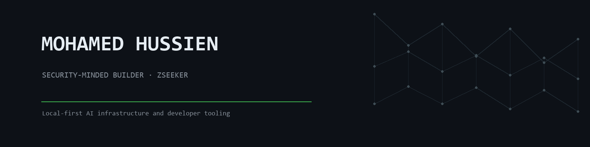

  

<h3 align="center">Security-minded builder. Local-first AI infrastructure and developer tooling.</h3>

  I build tools that keep your data on your machine and keep agents honest about where their context came from.

---

## Building now

**[ContextLedger](https://github.com/MohamedHussien-zseeker/ContextLedger)** — Git for AI memory. Local-first, human-editable memory infrastructure for AI agents: Markdown vault, SQLite FTS5 search, CLI + REST + MCP. GPL-3.0, 93 tests.

**[mowazaf](https://github.com/MohamedHussien-zseeker/mowazaf)** — Multi-tenant AI agent SaaS across WhatsApp and Telegram. V1 MVP with tenant isolation.

**[mw2cr-vr-by-zseeker](https://github.com/MohamedHussien-zseeker/mw2cr-vr-by-zseeker)** — Unofficial VR build for MW2 Campaign Remastered.

## Selected work

| Repo | What it does |
| --- | --- |
| [ai-dev-brain-kit](https://github.com/MohamedHussien-zseeker/ai-dev-brain-kit) | Session handoffs and context preservation across coding sessions |
| [sourcewell](https://github.com/MohamedHussien-zseeker/sourcewell) | Collects real UI components and templates into one offline searchable index |
| [SaveSync](https://github.com/MohamedHussien-zseeker/SaveSync) | Automatic backup, sync and restore for PC game saves |
| [github-humanize](https://github.com/MohamedHussien-zseeker/github-humanize) | Strips the AI tell out of agent-generated commits and PRs |

## Stack

`Python` · `TypeScript` · `SQLite` · `FastAPI` · `MCP` · `Docker` · `Linux` · `Bash`

  
  

## Background

Offensive security first — TryHackMe rooms, CTFs, pentest writeups. That's where the local-first and least-privilege instincts come from. All of it is consolidated in [ctf-writeups](https://github.com/MohamedHussien-zseeker/ctf-writeups).

## Contact

[LinkedIn](https://www.linkedin.com/in/mohamed-hussien-0435aa246/) · [ContextLedger](https://github.com/MohamedHussien-zseeker/ContextLedger)
